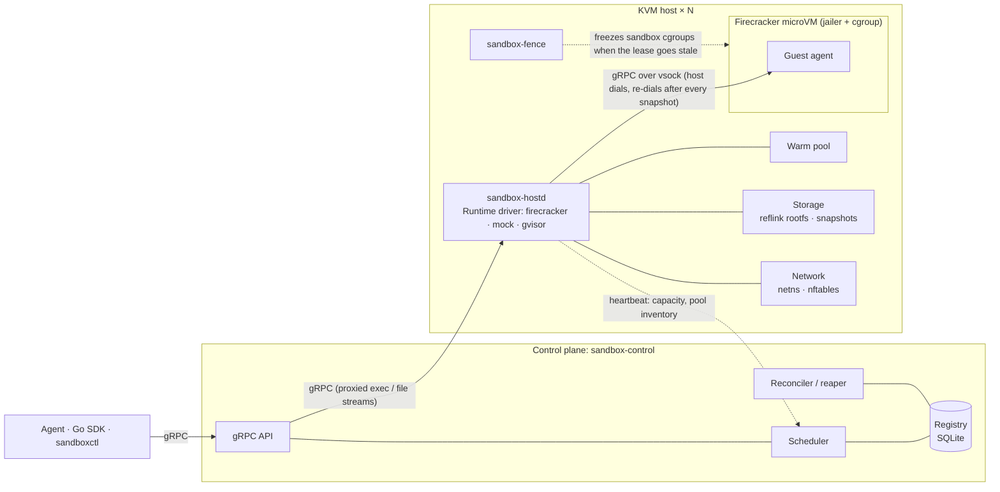

# agent-sandbox

A runtime that hands AI agents isolated Linux environments on demand. Agents create a sandbox, run commands in it with output streamed back over gRPC, move files in and out, snapshot it, fork it in the middle of a task, and destroy it. Each sandbox is a Firecracker microVM. gVisor is planned as a second backend.

Every coding agent needs something like this. [E2B](https://e2b.dev), [Modal](https://modal.com) and [Daytona](https://daytona.io) sell it as a product. This project builds the core from scratch, covering the hard parts:

- fast cold starts from warm pools and memory-snapshot restore
- cheap forks of a running sandbox, built on diff snapshots and copy-on-write files
- exec streams that survive snapshots, restores and forks
- cgroup limits and network egress allowlists
- a placement scheduler that spans multiple hosts and handles host death without running two copies of a sandbox
- reaping of idle sandboxes

> **Status: pre-alpha.** Nothing is implemented yet. This README is the development plan and doubles as the progress tracker: tick the boxes as work lands. The first milestone is [v0.1](#milestone-v01): one host, fast starts and forks, with published numbers.

**Contents:** [API](#api-v1) · [Architecture](#architecture) · [Key decisions](#key-decisions) · [Development environment](#development-environment) · [Development plan](#development-plan) · [Proof metrics](#proof-metrics) · [Repository layout](#repository-layout) · [Risks](#risks--mitigations) · [Non-goals](#non-goals-v1)

---

## API (v1)

One gRPC service, with a Go SDK (`pkg/sdk`) and a CLI (`sandboxctl`) on top.

```proto
service SandboxService {
  rpc Create(CreateRequest)       returns (Sandbox);
  rpc Get(GetRequest)             returns (Sandbox);       // includes live exec sessions
  rpc List(ListRequest)           returns (ListResponse);
  rpc Destroy(DestroyRequest)     returns (DestroyResponse);
  rpc Keepalive(KeepaliveRequest) returns (KeepaliveResponse);

  // Client sends start + stdin + signals; server streams stdout/stderr chunks with byte offsets, then exit status.
  rpc Exec(stream ExecInput)      returns (stream ExecOutput);
  // Re-attach to a live exec session from a byte offset: after a client reconnect, or in a fork child.
  rpc Attach(stream AttachInput)  returns (stream ExecOutput);
  rpc Upload(stream UploadChunk)  returns (UploadResponse);
  rpc Download(DownloadRequest)   returns (stream DownloadChunk);

  rpc Snapshot(SnapshotRequest)   returns (SnapshotRef);   // pause, capture memory + disk, resume
  rpc Fork(ForkRequest)           returns (ForkResponse);  // n live children of a running sandbox
  rpc Restore(RestoreRequest)     returns (Sandbox);       // new sandbox from a stored snapshot
}
```

`CreateRequest` carries:

- `template`: an image, a guest kernel, a warm-up command and an optional `post_restore` hook (see [Key decisions](#key-decisions), clone uniqueness)
- `vcpus`, `memory_mib`, `disk_gib`
- `env`
- `egress` policy
- `idle_timeout`, `max_lifetime`
- `labels`

`ForkRequest` carries:

- `count`
- `mode`: `AUTO`, `DIFF` or `FULL`. `AUTO` uses diff snapshots; `FULL` exists as a fallback and a benchmark baseline
- `inherited_sessions`: `KEEP` leaves the parent's running processes alive in each child, detached and reachable with `Attach`; `KILL` ends them during post-restore

Exec semantics:

- Each exec runs in its own session and process group. Signals and timeouts go to the whole group, so background children don't outlive it.
- Output is never dropped. When nobody is reading, the guest agent stops draining the process's pipes and the process blocks on write.

Sandbox states: `PENDING → RUNNING ⇄ HIBERNATED → DESTROYED`, plus the terminal states `FAILED` and `LOST` (the host died).

## Architecture



| Component | Binary | Responsibility |
|---|---|---|
| Control plane | `sandbox-control` | Public API, auth, sandbox registry, placement, host leases, reconciliation, stream proxying |
| Host agent | `sandbox-hostd` | One per KVM host. VM lifecycle via a `Runtime` driver, warm pools, rootfs/snapshot storage, netns/nftables, cgroups, local reaper, orphan GC, re-adopting live VMs after a restart |
| Fence | `sandbox-fence` | One per KVM host, separate from `hostd`. Freezes every sandbox's cgroup when `hostd` stops renewing its lease, including when `hostd` itself hangs or crashes |
| Guest agent | `sandbox-guest` | Runs inside every microVM. Exec sessions that outlive connections (streams, stdin, signals, exit codes), file ops, readiness, post-restore fixups |
| SDK / CLI | `pkg/sdk`, `sandboxctl` | Client library and command line |
| Bench | `sandbox-bench` | Load generator for TTFE, density, fork and throughput |

The `Runtime` interface has three implementations:

- **`firecracker`**: the real driver.
- **`mock`**: in-process, with configurable latencies and fault injection. It is used for local development and chaos tests.
- **`gvisor`**: optional, added late.

## Key decisions

Each row becomes an ADR in `docs/adr/` during P0.

| Area | Decision | Why |
|---|---|---|
| Language | Go everywhere | [firecracker-go-sdk](https://github.com/firecracker-microvm/firecracker-go-sdk), first-class gRPC, static binaries that are easy to ship to hosts and guests |
| Isolation | Firecracker microVMs under the jailer; gVisor optional later | Hardware virtualization boundary, tiny VMM, first-class memory snapshots |
| Firecracker version | Pinned to a release that includes the vsock transport-reset fixes (issues [#4736](https://github.com/firecracker-microvm/firecracker/issues/4736), [#4811](https://github.com/firecracker-microvm/firecracker/issues/4811)) | Snapshot formats and snapshot behavior change between releases. Snapshots are rebuilt whenever the version changes |
| Host↔guest | gRPC over virtio-vsock. The guest listens and the host dials. Exec sessions live in the agent, not in the connection, and `hostd` re-attaches each one from its last acknowledged offsets after any reconnect | Firecracker resets vsock on every snapshot: open connections close in the snapshotted VM and in every restore, while listening sockets in the guest survive. In tests the same protocol runs over a unix socket |
| Guest init | Decided in P1: a minimal init that reaps zombies and supervises the agent, or the agent itself as PID 1 | If PID 1 exits, the guest kernel panics, and whichever process is PID 1 must reap orphans |
| Root filesystem | OCI image → ext4 file, then a per-sandbox **XFS reflink** copy | Near-constant-time copy-on-write. Firecracker drives are plain files, so a fork is just another reflink. dm-thin is a later optimization if needed |
| Memory snapshots | File-backed memory, mapped `MAP_PRIVATE` on restore. A golden memory file is **hard-linked** (or bind-mounted) into each jail, never copied or reflinked | Clones share clean pages through the page cache, which is per inode. A copy or reflink is a new inode and silently stops sharing. Jails and the snapshot store live on the same XFS volume so hard links work |
| Memory accounting | Golden and merged memory files are pre-read inside a dedicated `snapshots` cgroup, protected from reclaim with `memory.low` | The kernel charges a page-cache page to the cgroup that first faults it in. Without this, the first sandbox restored from a template is billed for pages every sandbox shares and can hit its `memory.max` |
| Fork | Diff snapshot of the parent, rebased onto a reflinked copy of its base memory file. Full snapshots are kept as a fallback and baseline | A full snapshot writes all guest memory while the parent is paused, which is too slow for a cheap fork. Diff snapshots write only dirty pages, but they are in developer preview and can't be resumed on their own |
| Clone uniqueness | VMGenID (guest kernel built with `CONFIG_VMGENID`), a `PostRestore` RPC, and per-template `post_restore` hooks | VMGenID reseeds only the kernel PRNG. Processes captured in a snapshot keep identical userspace RNG state and memory layout in every clone |
| Networking | One netns per sandbox. The guest IP/MAC is the same in every sandbox; veth + SNAT on the host side; nftables for policy. IPv4 only in v1 | Clones of one snapshot share guest network identity, and the netns isolates them. This is Firecracker's [network-for-clones](https://github.com/firecracker-microvm/firecracker/blob/main/docs/snapshotting/network-for-clones.md) pattern. Firecracker can rename the host TAP at restore, but the netns is still what lets every sandbox share one guest IP. Dropping IPv6 also closes AWS's IPv6 metadata address |
| CPU compatibility | One instance family per cluster, with the CPU platform pinned where a family spans more than one generation. Snapshots are tagged with CPU model and Firecracker version and checked on restore | Snapshots only restore on a compatible CPU and the same Firecracker version |
| Control-plane state | SQLite, single instance in v1 | Simple. Hosts report what is actually running, so a control-plane restart loses no sandboxes |
| Durability | Sandboxes are ephemeral; only exported snapshots are durable | Honest semantics: a dead host's RAM is gone |
| Stream routing | The control plane proxies streams in v1. Later, clients connect straight to the host with short-lived tokens bound to the host's epoch | One routing/auth point first. The extra hop comes out when TTFE needs it |

### What happens when a host dies

Timings are initial values, tuned in P5. The invariant that matters is **self-fence deadline < lease TTL < dead timeout**: a host always stops its own sandboxes before the control plane could start replacements.

1. `hostd` heartbeats every **2 s** to renew a **10 s** lease. It measures lease age on the monotonic clock from when it *sent* its last successful renewal, so its view of the lease always expires before the control plane's.
2. **Self-fencing at 8 s.** `hostd` records the send time of its last successful renewal in a file. `sandbox-fence` watches that file. If the recorded time is more than 8 s old, or `hostd` stops updating it because it hung or crashed, `sandbox-fence` freezes every sandbox's cgroup (cgroup v2 `cgroup.freeze`) and `hostd` refuses new creates. If renewals resume before the host is declared dead, the cgroups are thawed and exec streams re-attach.
3. **`SUSPECT` at 10 s** (lease expiry). Nothing new is placed on the host, and existing work is left alone.
4. **`DEAD` at 25 s**:
   - Its sandboxes move to **`LOST`**.
   - Proxied streams fail with `UNAVAILABLE`.
   - The SDK returns `ErrSandboxLost`.
5. **Nothing is recreated silently**, because the memory state died with the host. If the client opted in with `restore_on_host_failure` and an exported snapshot exists, that snapshot is restored on another host as a *new* sandbox, with its lineage recorded. The original was frozen at 8 s, so the copy never runs alongside it.
6. **Fencing:**
   - Each registration gets an epoch. A host that returns from a partition re-registers and is told to destroy everything marked `LOST`, which is already frozen.
   - When direct-to-host streams arrive, their tokens carry the epoch, and `hostd` rejects tokens from an older one.

## Development environment

The dev machine is an Apple M2 Mac, which has no KVM and can't do nested virtualization. Work is split three ways.

**Local (Mac): control plane, SDK, scheduler, reaper, fencing logic and guest-agent logic.**

- `make test`, `make lint`, `make proto`
- `make run-local`: control plane + 3 `hostd` processes on the `mock` driver, a whole cluster on a laptop
- `make chaos-local`: kill, partition, hang and slow down mock hosts
- The guest agent's exec, file and reconnect logic is tested over a unix socket, including forced transport drops mid-stream.
- Binaries cross-compile to `linux/amd64` for hosts and guests.

**Cloud with nested virtualization: Firecracker work, image builds, multi-host tests.**

- Instances:
  - **GCP**: Intel machine types created with `--enable-nested-virtualization`, with `--min-cpu-platform` pinned so every host gets the same CPU generation.
  - **AWS**: C8i/M8i/R8i with nested virtualization enabled.
  - Use one provider and **one instance family** per cluster, so golden snapshots stay CPU-compatible across hosts.
- Storage: the XFS volume sits on local SSD where the instance type offers it. Jail roots and the snapshot store share that volume, so golden memory files can be hard-linked into jails. Network-attached disks work but slow snapshot numbers down, and results say which was used.
- `make dev-up` / `make dev-down` start and stop the dev VM. Its persistent disk keeps build artifacts and snapshots between sessions.
- `make deploy-dev` cross-compiles, rsyncs and restarts the systemd units.
- `make vm-smoke`, `make itest-remote`, `make bench-remote`
- `make cluster-up N=3` / `make cluster-down` handle multi-host tests.
- Host setup:
  - cloud-init bootstrap
  - pinned Firecracker + jailer versions
  - `/dev/kvm` permissions
  - an XFS volume with reflink
  - nftables, `ip_forward`, IPv6 disabled for sandbox interfaces
  - cgroup slices: one for sandboxes, one `snapshots` slice with `memory.low`
  - systemd units for `hostd` and `sandbox-fence`
  - a prebuilt guest kernel with `CONFIG_VMGENID`
- **Idle auto-shutdown**: a systemd timer powers the VM off after 30 minutes with no SSH session, running sandboxes or benchmark.
- Linux-only steps, such as building rootfs images, run on the dev VM.

**Bare-metal window: headline benchmarks.**

- A few hours on a `.metal` instance from the same CPU family as the nested-virt hosts, in P7 and optionally at v0.1.
- The benchmark suite runs unchanged.
- Results are published next to the nested-virt numbers, never in place of them.

## Development plan

**Sizes:** S ≈ a few days · M ≈ 1–2 weeks · L ≈ 2–4 weeks of focused work. **Tags:** `local` = Mac + mock driver, `cloud` = nested-virt KVM host.

**Sequencing:**

- The critical path is P0 → P1 → P2 → P3 → P4 → **[v0.1](#milestone-v01)** → P5 → P6 → P7.
- The `local` parts of P5 and P6 only need the mock driver, so they can run on the Mac in parallel from P1 onward.
- P8 is optional.
- `sandbox-bench` grows from P1 on, and each phase appends its numbers to `docs/benchmarks.md`.

### P0: Foundations (S)

Goal: a repo, a toolchain, and a dev VM that boots a microVM.

- [ ] `local` Go module, [repository layout](#repository-layout), Makefile, golangci-lint, `buf` for protos
- [ ] `local` First draft of `api/proto/sandbox/v1` and the generated Go stubs
- [ ] `local` `Runtime` driver interface (`Create/Start/Exec/Pause/Resume/Snapshot/Restore/Destroy/Stats`) and the in-process `mock` driver with latency and fault injection
- [ ] `local` GitHub Actions: build, lint, unit tests, mock-driver integration tests
- [ ] `cloud` `deploy/cloud/`: create/start/stop scripts for a nested-virt dev VM (GCP or AWS), plus the cloud-init bootstrap
- [ ] `cloud` `deploy/host/`: host setup with pinned Firecracker + jailer, KVM permissions, XFS reflink volume, nftables, sysctls, cgroup slices, guest kernel
- [ ] `cloud` Idle auto-shutdown timer
- [ ] `cloud` `make vm-smoke`: boot a microVM from a kernel + minimal rootfs and read its serial console
- [ ] ADRs for every row in [Key decisions](#key-decisions)

**Exit:** CI is green, and `make dev-up && make vm-smoke && make dev-down` works from the Mac.

### P1: Vertical slice (L)

Goal: create → exec → files → destroy, end to end on one host, with exec streams that survive a dropped transport.

- [ ] `local` Guest agent exec sessions:
  - each exec in its own session and process group; signals and timeouts go to the group
  - stdout/stderr ring buffers with absolute byte offsets; backpressure on the pipes instead of dropping output
  - stdin with sequence numbers, so re-sent input after a reconnect isn't applied twice
  - exit status kept until the host acknowledges it
  - env/cwd/user
- [ ] `local` Guest agent file ops (read/write/stat/mkdir) and a readiness probe. The transport is pluggable: vsock in the VM, unix socket in tests
- [ ] `local` Reconnect protocol: `hostd` re-dials with backoff and re-attaches every live session from its last acknowledged offsets. Tests force transport drops mid-stream
- [ ] `local` Guest init ADR (minimal init or agent as PID 1) and a zombie-reaping test
- [ ] `cloud` Image pipeline: Dockerfile → exported rootfs → ext4 (`mkfs.ext4 -d`), with the guest agent and init injected. The guest kernel is built from Firecracker's recommended config with `CONFIG_VMGENID` enabled
- [ ] `cloud` `hostd` Firecracker driver: per-sandbox reflinked rootfs, boot, wait for the agent, dial vsock, destroy with full cleanup
- [ ] `local` Control plane v1: API server, SQLite registry, single-host placement, stream proxying to `hostd`
- [ ] `local` Go SDK + `sandboxctl` (`create`, `exec`, `attach`, `cp`, `ls`, `rm`)
- [ ] `local` Max-lifetime TTL reaper, so dev hosts don't leak VMs
- [ ] `cloud` `sandbox-bench ttfe` skeleton

**Exit:**

- `sandboxctl create --template python` followed by `sandboxctl exec <id> -- python -c 'print(1)'` works against the cloud host, and a cold-boot TTFE baseline is recorded.
- A transport dropped in the middle of an exec loses and duplicates no bytes.

### P2: Baseline isolation (M)

Goal: a sandbox can't hurt its neighbors, the host, or the network. Domain allowlists and the full adversarial suite come in P7.

- [ ] `cloud` Jailer: chroot per VM on the XFS volume, unprivileged uid/gid, default seccomp filters
- [ ] `cloud` cgroup v2 per VM: `cpu.max`, `memory.max` (guest memory plus VMM overhead; shared snapshot pages are charged to the `snapshots` cgroup instead), `pids.max`
- [ ] `cloud` Firecracker rate limiters on block and net devices; fixed-size disks
- [ ] `cloud` Networking: a netns per sandbox, a veth to the host, a tap inside the netns, the same guest IP everywhere, SNAT on egress, IPv6 disabled in the netns
- [ ] `cloud` nftables egress policy: default deny, CIDR:port allowlist. Always blocked: cloud metadata (`169.254.169.254`), host addresses, other sandboxes. All IPv6 is dropped, which also covers AWS's IPv6 metadata address (`fd00:ec2::254`)
- [ ] `local` `egress` policy in the API, with validation (CIDR:port rules now; domain rules arrive in P7)
- [ ] `cloud` Containment smoke tests: fork bomb, memory hog, metadata endpoint, non-allowlisted address

**Exit:**

- A fork bomb and a memory hog each stay inside their own sandbox.
- Egress fails for non-allowlisted addresses, the metadata endpoint (IPv4 and IPv6), the host and other sandboxes.

### P3: Fast starts with snapshots and warm pools (L)

Goal: creating a sandbox is a restore, not a boot.

- [ ] `cloud` Templates with **golden snapshots**: boot → agent ready → warm-up → pause → snapshot. Each snapshot is tagged with its CPU model, Firecracker version, guest kernel and template hash, and is rebuilt when any of them changes. Warm-ups should not leave stateful processes running unless the template's `post_restore` hook restarts them
- [ ] `cloud` Restore with file-backed `MAP_PRIVATE` memory and dirty-page tracking on (needed for diff forks in P4). Golden memory files are hard-linked into each jail
- [ ] `cloud` Page-sharing test: two sandboxes from one template map the same inode, and PSS is well below RSS
- [ ] `cloud` `snapshots` cgroup: the pool manager pre-reads golden memory files inside it, and `memory.low` protects them from reclaim
- [ ] `cloud` `PostRestore`, in order: re-dial vsock → reseed (VMGenID handles the kernel PRNG; the host also injects fresh entropy) → set the clock → set hostname and sandbox ID → run the template's `post_restore` hook
- [ ] `cloud` Tiered pool: paused pre-restored VMs (claiming one = resume + `PostRestore`), then restore from the golden snapshot, then cold boot as the fallback
- [ ] `cloud` Pre-provisioned side resources: netns + tap + nft tables, jailer chroots, reflinked disks
- [ ] `local` Pool manager: per-template target size, refill concurrency, host memory budget (tested against `mock`)
- [ ] `local` OpenTelemetry spans for each create: schedule → claim → restore → network → identity → agent ready → first byte
- [ ] `cloud` `sandbox-bench ttfe` at concurrency 1, 16 and 64

**Exit:**

- TTFE p50/p99 is reported for pool hit, pool miss and cold boot, with a per-span breakdown.
- The page-sharing test passes.

### P4: Snapshot and fork (L)

Goal: forking a running sandbox in the middle of a task is cheap and correct.

- [ ] `cloud` `Snapshot`: pause → full or diff snapshot → reflink the rootfs while paused → resume → re-attach exec sessions. Pausing first keeps memory, page cache included, consistent with the disk
- [ ] `cloud` `Fork(n)` in diff mode:
  1. Pause the parent, write a diff snapshot (pages dirtied since its last snapshot or restore), reflink its rootfs, resume. This is the parent's blackout.
  2. Reflink the parent's base memory file (the golden file, or the merged file from its previous fork) and rebase the diff into the copy with `snapshot-editor edit-memory rebase`, inside the `snapshots` cgroup.
  3. Hard-link the merged file into each child's jail and restore n children from it. Each child gets its own reflinked disk, a pooled netns and `PostRestore`.
  4. The merged file becomes the parent's base for its next fork.
- [ ] `cloud` `Fork(n)` in full mode: the same flow with a full snapshot and no rebase, kept as a fallback and a baseline
- [ ] `cloud` Inherited sessions: `KEEP` leaves the parent's processes running in each child, detached and reachable with `Attach`; `KILL` ends them in `PostRestore`
- [ ] `cloud` Snapshot store on local disk with refcounts
- [ ] `cloud` `Restore`: a new sandbox from any stored snapshot
- [ ] `local` Snapshot lineage (parent → snapshot → children) in the API, registry and SDK
- [ ] `cloud` Fork-correctness tests, run in both modes:
  - children diverge independently, and the parent keeps running unaffected
  - an Exec streaming in the parent during a Fork completes with no lost or duplicated output
  - `/dev/urandom` output differs between children
  - a long-lived process restarted by a `post_restore` hook produces different random output in each child (without the hook, the test documents that its output is identical)
  - network identity differs between children
- [ ] `cloud` `sandbox-bench fork` matrix: guest memory 256 MiB / 1 GiB / 4 GiB × 10% / 50% dirty × diff / full mode
- [ ] *Stretch:* a UFFD page-fault handler for lazy memory loading on large guests

**Exit:**

- Fork latency p50/p99 and parent blackout time are reported across the matrix, in both modes.
- The fork-correctness tests pass in both modes.

### Milestone v0.1

One host, fast starts and cheap forks, with numbers anyone can check.

- [ ] Tag `v0.1.0`
- [ ] Publish `docs/benchmarks.md` v0.1 with the nested-virt column. Optionally run the bare-metal window here too, so the first published numbers include bare metal
- [ ] Write-up: golden snapshots and page sharing, the diff fork pipeline, and keeping exec streams alive across vsock resets

### P5: Multi-host scheduling and host failure (L)

Goal: many hosts, sensible placement, and correct, documented behavior when a host dies.

- [ ] `local` Host registration and heartbeats (capacity, pool inventory, snapshots held) with a lease TTL
- [ ] `local` Placement:
  - Filter: healthy, not cordoned, template available, capacity under the overcommit ratio.
  - Score: warm-pool hit, snapshot locality (forks stay on the parent's host), spread by default with an optional bin-pack mode.
- [ ] `local` Admission control: CPU and memory overcommit ratios, plus disk (provisioned `disk_gib` counted against free space on the host's XFS volume, with a hard floor). Rejections return `RESOURCE_EXHAUSTED` with retry hints
- [ ] `local` Demand-driven pool targets per host (EWMA of the create rate for each template)
- [ ] `cloud` Snapshot export to GCS/S3/MinIO, and restore on another host (same CPU family and Firecracker version only)
- [ ] `local` Host failure state machine, `LOST` handling and opt-in restore, as described in [What happens when a host dies](#what-happens-when-a-host-dies)
- [ ] `local` Self-fencing logic, plus `cloud` `sandbox-fence` with cgroup freezing. Tested with a partitioned host, a hung `hostd` and a killed `hostd`
- [ ] `local` Epoch fencing
- [ ] `local` `hostd` restart: re-adopt live VMs from their jails instead of killing them
- [ ] `local` Control-plane restart: rebuild running state from `hostd` reports. Hosts are the truth for what is running; the registry is the truth for what should be
- [ ] `local` Cordon and drain
- [ ] `local` `make chaos-local`: kill, partition and hang mock hosts, delay heartbeats
- [ ] `cloud` A 3-VM cluster: load test, then chaos mid-load (kill `hostd`, stop a VM, partition a VM)

**Exit:**

- No sandbox is reported `RUNNING` on a dead host after the dead timeout.
- During a partition, every sandbox on the cut-off host is frozen before any restored copy starts, checked from host and control-plane event logs.
- No duplicate sandboxes exist after a partition heals.
- Load spreads across 3 hosts.

### P6: Lifecycle and hygiene (M)

Goal: idle sandboxes go away, and nothing leaks.

- [ ] `local` Activity tracking: exec start and I/O, file ops and keepalives update `last_active_at`
- [ ] `local` Per-sandbox `idle_timeout` (default 10 min) and `max_lifetime` (default 24 h)
- [ ] `cloud` Reaper inside `hostd`, so it keeps working during a control-plane outage; the control plane reconciles
- [ ] `cloud` Orphan GC at `hostd` startup and periodically, for anything not re-adopted: tap devices, netns, nft tables, cgroups, jailer chroots, disk files, zero-ref snapshots
- [ ] `cloud` Optional `on_idle: hibernate`: snapshot to disk, free the memory, and resume transparently on the next request, with exec sessions re-attaching (resume latency is measured)
- [ ] `cloud` 24-hour churn soak test

**Exit:** the soak test ends with zero leaked resources (counted before and after) and no sandbox reaped while active.

### P7: Hardening and final benchmarks (M)

Goal: a defensible security story and publishable headline numbers.

- [ ] `cloud` Domain allowlist: a DNS proxy that resolves only allowed names and puts the answers into the sandbox's nft set with a TTL. Documented limit: allowing a domain also allows other sites that share its IP addresses, as on CDNs
- [ ] `cloud` Adversarial suite: fork bomb, memory hog, disk fill and CPU spin, with a neighbor's TTFE p99 staying within 20% of its unloaded value
- [ ] `cloud` The full benchmark matrix on nested virt
- [ ] Bare-metal window: the same suite, unchanged, on a `.metal` instance from the same CPU family
- [ ] Density runs with and without the balloon device and KSM. KSM needs an explicit opt-in for the Firecracker processes; check that it covers the guest memory mapping
- [ ] Fuzz the guest-agent protocol and API inputs (`go test -fuzz`)
- [ ] `docs/threat-model.md`, covering guest → host, sandbox → sandbox, sandbox → network, tenant → control plane, and state duplicated across clones (userspace RNGs, memory layout)
- [ ] Publish `docs/benchmarks.md`: methodology, hardware, versions, nested-virt and bare-metal columns

**Exit:**

- The adversarial suite passes.
- Headline numbers are published, and every number says which environment produced it.

### P8: gVisor driver (M, optional)

Goal: a second isolation backend behind the same interface.

- [ ] `runsc` driver: OCI bundle from the same template image, the systrap platform (no KVM needed, so it also runs in a Linux VM on the Mac), an overlay rootfs
- [ ] Exec and file ops through the same guest agent, or through `runsc exec`
- [ ] Snapshot and fork via `runsc checkpoint` / `runsc restore`
- [ ] A driver conformance suite shared by every `Runtime` implementation

**Exit:** the conformance suite passes on both `firecracker` and `gvisor`, with a side-by-side table of TTFE, density and fork latency.

## Proof metrics

The targets below are for **bare metal**. They are initial guesses, to be revised after the P3 baseline. Nested-virt results are always reported in their own column.

| Metric | Definition | Target |
|---|---|---|
| **TTFE**, warm-pool hit | Measured on the client, from sending `Create` to receiving the first stdout byte of `Exec("echo ok")` | p50 ≤ 50 ms, p99 ≤ 150 ms |
| **TTFE**, pool miss | Same definition, served by restoring a golden snapshot | p50 ≤ 200 ms, p99 ≤ 500 ms |
| **TTFE**, cold boot | Same definition, served by a full kernel boot | Reported as a baseline only |
| **Density** | Concurrent idle sandboxes (1 vCPU, 256 MiB, after one exec) per host, counted until new-sandbox TTFE p99 doubles or memory pressure appears (PSI or swap). Also reports PSS per sandbox | ≥ 2× memory overcommit, e.g. ≥ 500 on a 64 GiB host |
| **Fork latency** | From the `Fork` RPC to the child accepting exec | Diff mode, 1 GiB guest, 10% dirty: p50 ≤ 150 ms, p99 ≤ 400 ms. Full mode reported as a baseline |
| **Parent blackout** | How long the parent is paused during a fork | Diff mode, same config: ≤ 100 ms. Full mode reported as a baseline |
| **Create throughput** | Sustained creates per second per host | ≥ 50/s |

Methodology:

- The benchmark client runs in the same zone as the control plane, never on the Mac.
- Each cell gets at least 1,000 samples at concurrency 1, 16 and 64, reported as p50, p90, p99 and max.
- Every run records the host type, host kernel, Firecracker version, guest config, and where memory files lived (local SSD, network disk, or already in page cache).
- For reference, Firecracker's own published figures are ~125 ms to guest userspace, < 5 MiB VMM overhead and up to 150 microVMs/s per host.

## Repository layout

```text
api/proto/sandbox/v1/          gRPC API (buf)
cmd/
  sandbox-control/             control plane
  sandbox-hostd/               per-host agent
  sandbox-fence/               per-host self-fencing watchdog
  sandbox-guest/               in-VM agent
  sandboxctl/                  CLI
  sandbox-bench/               load generator and benchmarks
pkg/sdk/                       public Go SDK
internal/
  control/{api,registry,scheduler,reaper}/
  host/
    runtime/{firecracker,mock,gvisor}/
    pool/ storage/ network/ cgroup/ fence/
  guest/                       exec sessions, reconnect, file ops, post-restore
images/                        template Dockerfiles, rootfs build, guest kernel config
deploy/
  cloud/                       dev VM / cluster scripts (GCP, AWS), cloud-init
  host/                        host bootstrap, systemd units, cgroup slices
docs/
  adr/                         architecture decision records
  benchmarks.md
  threat-model.md
```

## Risks & mitigations

| Risk | Mitigation |
|---|---|
| Nested-virt numbers mislead | Label every number with its environment; take headline numbers only from the bare-metal window |
| Diff snapshots are in developer preview | Full-snapshot fork path kept and benchmarked side by side; pinned Firecracker version; fork-correctness tests run in both modes |
| vsock connections reset on every snapshot and restore | Exec sessions live in the guest agent and re-attach by offset; continuity tests in P1 and P4; Firecracker pinned to a release with the reset fixes |
| Page sharing silently lost | Golden memory files only ever hard-linked into jails; an inode assertion test; PSS reported in every density run |
| Shared pages charged to one sandbox | Pre-read inside the `snapshots` cgroup, protected with `memory.low` |
| Snapshots are tied to the CPU model and Firecracker version | One instance family per cluster with the CPU platform pinned; golden snapshots per host type; metadata check on restore; pinned versions |
| Clones share kernel identity (RNG, clock, network, vsock) | VMGenID, the `PostRestore` protocol, netns per sandbox, and fork-correctness tests that assert divergence |
| Clones share userspace state (RNG state, memory layout of processes captured in the snapshot) | `post_restore` hooks, guidance to keep warm-ups stateless, tests, and a threat-model section |
| A partitioned host keeps running sandboxes that get restored elsewhere | `sandbox-fence` freezes them before the control plane can declare the host dead; epoch fencing on return |
| Sandboxes reach the cloud metadata endpoint on dev hosts | IPv4 endpoint blocked and all IPv6 dropped by default; covered by the smoke tests and the adversarial suite |
| Memory overcommit leads to OOM storms | Admission control, balloon device, PSI-based backpressure on placement |
| Sparse reflinked disks fill the host volume | Provisioned disk counted in admission control, a free-space floor, alerts |
| Idle cloud VMs keep costing money | Auto-shutdown timer, `make dev-down`, persistent disks so stopping is cheap |
| Scope creep | The v0.1 milestone cut, explicit non-goals below, and stretch items marked as such |

## Non-goals (v1)

- A highly available control plane (it runs as a single instance with SQLite)
- Live migration (cold migration through exported snapshots is the most on offer)
- GPUs or Windows guests
- Kubernetes integration
- Multi-tenant billing or auth beyond API tokens
- TLS-intercepting egress filtering (egress filtering stops at domains via DNS)

## License

[MIT](LICENSE)
